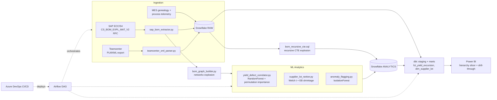

# Semiconductor Yield Intelligence Pipeline
### BOM-Aware Defect Correlation — Snowflake + ML + Power BI

When yield drops on a wafer, fab engineers spend **2–3 days** manually
cross-referencing which component revision, supplier batch or process step
caused it — **$500K+ per unplanned excursion**. No off-the-shelf tool does
*BOM-version-aware* defect correlation at speed.

This project is a working, end-to-end implementation: a Snowflake-native BOM
explosion engine plus an ML defect-correlation pipeline that links yield
excursions back to **specific BOM revisions, supplier batches, or process
parameter deviations**, with drill-down Power BI dashboards on top.

## Measured results (local run, `scripts/run_pipeline_local.py`)

| KPI | Target | Measured |
|---|---|---|
| BOM explosion (8,000-node, multi-level DAG) | < 2 min (manual: ~3 days) | **0.13 s** |
| Automated root-cause shortlist | < 10 min (manual: 2–3 days) | **34 s**, holdout R² = 0.885 |
| Injected root causes recovered | 3 of 3 | **3 of 3, ranked #1/#2/#3** |
| Single-batch cost impact quantified | per run | **$2.48 M** for the worst batch |

The synthetic dataset hides three known root causes (a bad photoresist batch
`SL-APX-4471`, electrostatic-chuck revision `C`, and an etch-chamber
temperature drift). The pipeline never sees the answer key — yet the Random
Forest permutation-importance shortlist recovers all three as its top three
factors, and the CI smoke gate (`--validate`) fails the build if it ever
stops doing so.

A subtle point the demo shows well: naive per-batch yield deltas are heavily
**confounded** (any batch consumed in the same calendar window as a bad batch
looks bad too). The ML layer disentangles this — only the truly causal factors
get high permutation importance.

## Architecture



## Repository layout

```
├── bom/
│   ├── sap_bom_extractor.py         # SAP RFC/BAPI -> JSON BOM tree (+ mock gateway)
│   ├── teamcenter_xml_parser.py     # Teamcenter PLMXML -> normalized tables (streaming)
│   └── bom_graph_builder.py         # networkx: multi-level BOM explosion / where-used
├── analytics/
│   ├── yield_defect_correlator.py   # Scikit-learn RF: BOM revision vs yield %
│   ├── supplier_lot_ranker.py       # Rank supplier lots by defect contribution
│   └── anomaly_flagging.py          # IsolationForest on process parameters
├── snowflake/
│   ├── bom_recursive_cte.sql        # Snowflake recursive BOM flattening + where-used
│   └── yield_mart_loader.py         # write_pandas bulk load (+ --dry-run)
├── dbt_models/                      # full dbt project (staging views + mart tables)
│   └── models/
│       ├── staging/  stg_bom, stg_wafer_lots, stg_lot_genealogy
│       └── marts/    fct_yield_excursion, dim_supplier_lot (+ schema tests)
├── airflow/dags/yield_intelligence_dag.py   # nightly DAG w/ KPI gate + excursion alert
├── powerbi/                         # DAX measures + 3-page report setup guide
├── data/generate_synthetic_data.py  # 8,000-node BOM + 600 lots w/ injected causes
├── scripts/run_pipeline_local.py    # END-TO-END local demo + validation
├── tests/                           # 12 pytest cases (graph, parsers, analytics)
└── azure-pipelines.yml              # Lint -> Test -> dbt compile -> gated Deploy
```

## Quickstart (no SAP / Snowflake needed)

```bash
pip install -r requirements.txt
python scripts/run_pipeline_local.py --validate
```

That one command generates the synthetic fab, extracts the BOM through the
mocked SAP RFC gateway, round-trips a Teamcenter PLMXML export, explodes the
8,000-node BOM, runs all three ML modules, prints the Snowflake load plan,
and writes `reports/root_cause_report.md` with the ranked shortlist and
ground-truth validation. Run `pytest tests -v` for the unit suite.

## How each layer works

**BOM ingestion.** `sap_bom_extractor.py` calls the single-level explosion
RFC `CS_BOM_EXPL_MAT_V2` (the function module behind transaction CS12)
recursively and stitches a JSON tree; a `MockSAPGateway` serves identical
STB-shaped responses from CSVs so everything runs offline. The Teamcenter
parser stream-parses PLMXML with `iterparse` (constant memory on 100 MB
exports) into `parts` / `revisions` / `occurrences` tables.

**BOM hierarchy engine.** `bom_graph_builder.py` loads edges into a
`networkx.DiGraph`, validates acyclicity (reporting the offending path),
and explodes any root iteratively — level, path string, and extended
quantity (product of qty-per along the path). Shared components under
multiple parents are handled per-usage-path, matching SAP CS12 semantics.
The same explosion exists warehouse-side as a **Snowflake recursive CTE**
(`snowflake/bom_recursive_cte.sql`) with a path-based cycle guard, plus a
where-used view and the `LOT_TO_BOM_PATH` bridge that makes correlation
BOM-version-aware.

**Defect correlation.** The correlator builds a per-wafer-lot feature matrix
from as-built genealogy — one-hot (component × revision) and (component ×
supplier batch) columns plus 10 process parameters — fits a
`RandomForestRegressor` on yield %, and ranks factors by **permutation
importance** on a holdout split (robust against one-hot cardinality bias).
Every shortlist entry carries observed yield delta and affected-lot count,
so it reads like an engineer's suspect list, not a feature dump.
`supplier_lot_ranker.py` adds per-batch Welch t-tests with empirical-Bayes
shrinkage and a dollar impact per batch; `anomaly_flagging.py` screens
telemetry with IsolationForest *before* yield data exists and explains each
flag via robust z-scores.

**Warehouse & BI.** `yield_mart_loader.py` bulk-loads raw + analytics layers
via `write_pandas`; dbt builds typed staging views and the two marts —
`fct_yield_excursion` (rolling 60-day robust baseline, excursion flag,
yield-loss cost) and `dim_supplier_lot` (usage + ML ranking + suspect-batch
flag) — with schema tests. Power BI (see `powerbi/`) ships a DAX measure
library including a PATH-based **BOM hierarchy slicer**, a supplier Pareto
with cumulative line, and an excursion **drill-through** page.

**Orchestration & CI/CD.** The Airflow DAG runs nightly: parallel ingestion →
explosion (fails the run if the 2-minute KPI is breached) → the three ML
tasks in parallel → Snowflake load → `dbt build` → Power BI refresh → a
branch that alerts only when new excursions appear. Azure DevOps runs
ruff + pytest + an end-to-end **ground-truth smoke gate**, parses dbt, and
deploys (Snowflake load, dbt prod run, DAG publish) behind a gated
environment on `main`.

## Production deployment

1. **SAP**: install the NW RFC SDK + `pyrfc`, set `SAP_ASHOST/SAP_USER/...`,
   drop `--mock`.
2. **Snowflake**: set `SNOWFLAKE_ACCOUNT/USER/PASSWORD`, run
   `python snowflake/yield_mart_loader.py` (creates `YIELD_INTEL` DB and all
   schemas), then `cd dbt_models && dbt deps && dbt build`.
3. **Airflow**: point the `yield_intel_project_root` Variable at the checkout;
   the DAG file is self-contained.
4. **Power BI**: follow `powerbi/POWERBI_SETUP.md`, import
   `powerbi/dax_measures.dax`.

## Tech stack

| Layer | Tools |
|---|---|
| BOM ingestion | Python (`pyrfc` SAP RFC/BAPI, PLMXML `iterparse`) |
| Hierarchy engine | Snowflake recursive CTEs + Python `networkx` |
| Defect correlation | scikit-learn (RandomForest, IsolationForest, permutation importance), pandas |
| Warehouse | Snowflake + dbt (staging/marts, schema tests, freshness) |
| Orchestration | Apache Airflow |
| Reporting | Power BI (DAX hierarchy slicer, Pareto, drill-through) |
| CI/CD | Azure DevOps (lint → test → smoke gate → gated deploy) |
"# semiconductor-yield-intelligence" 
"# semiconductor-yield-intelligence" 
"# semiconductor-yield-intelligence" 
